# TP 6 : Service Banque en CORBA

**Faculté des Sciences de Sfax – Département d'Informatique et des Communications**

**Matière :** Développement d'applications réparties – 

**Auditoire :** LSI 3 

**Année universitaire :** 2026 – 2027

**Étudiant(e) :** islem henteti

---

# Objectif

Implémenter une application distribuée client-serveur en Java avec le middleware CORBA pour gérer des comptes bancaires. Chaque compte est défini par un code et un solde. Le serveur permet de : créer un compte avec une somme initiale, verser, retirer, consulter un compte, consulter la liste des comptes et convertir un montant d'Euro (€) en Dinar Tunisien (DT).

# Environnement

- JDK 1.8
- IDE : Eclipse / IntelliJ IDEA / VS Code
- Git
- Outils CORBA du JDK : idlj et tnameserv

---

# Étape 1 : Préparation de l'espace de travail

Création du répertoire votreNomPrenom_LSI3_DevAppReparties, lancement de l'IDE avec ce répertoire comme Workspace, puis vérification du JDK 1.8 et de la variable PATH.

##  Vérification de l'environnement (java -version)
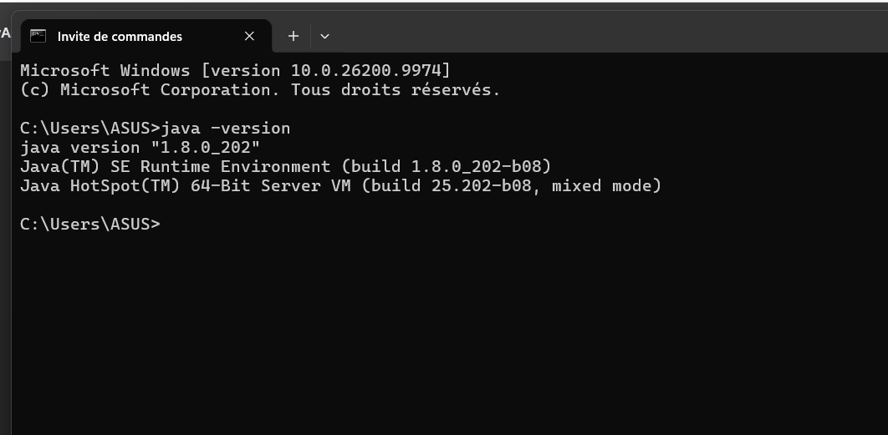

**Synthèse :** L'espace de travail est prêt, le JDK 1.8 est installé et le PATH est bien configuré. Les outils idlj et tnameserv sont accessibles.

##  Ajout .IDL
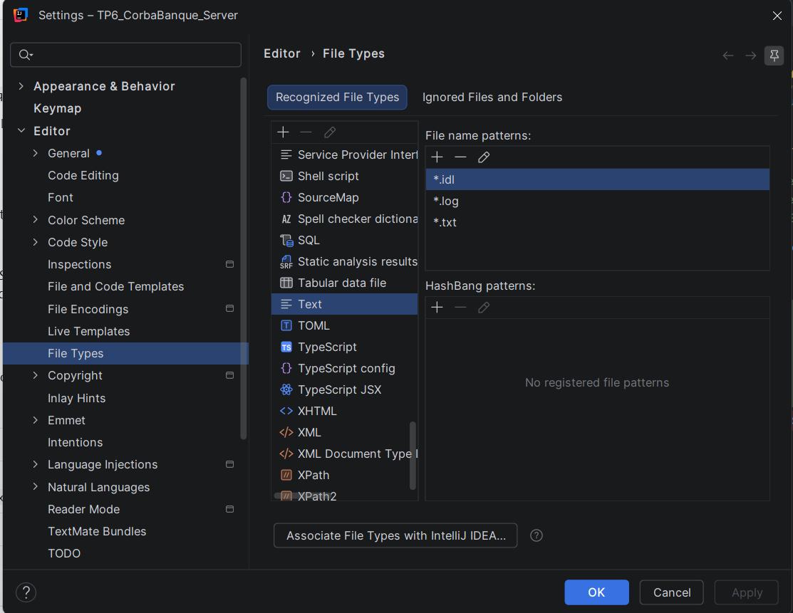
---

# Étape 2 : Développement du Serveur

##  Fichier Banque.idl
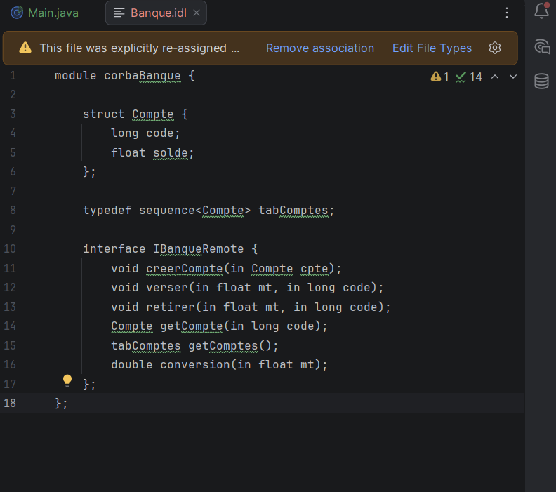

Le fichier Banque.idl déclare le module corbaBanque, la structure Compte (code : long, solde : float), l'alias tabComptes et l'interface IBanqueRemote avec les méthodes creerCompte, verser, retirer, getCompte, getComptes et conversion.

##  Compilation de Banque.idl avec la commande idlj -fall -v Banque.idl
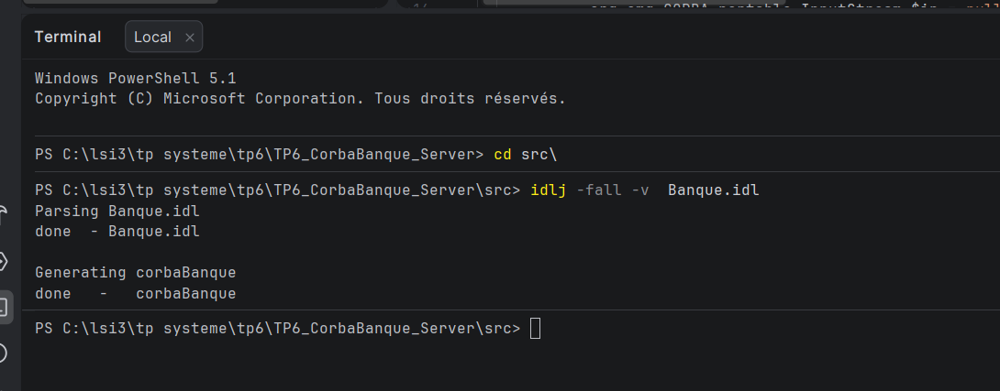

## Fichiers générés dans le package corbaBanque (après refresh)
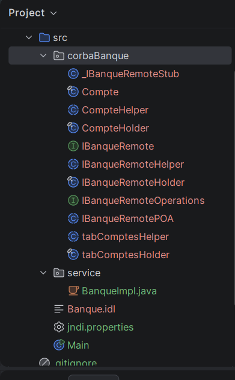

**Synthèse :** La compilation de l'IDL génère le Stub (côté client), le Skeleton IBanqueRemotePOA (côté serveur) ainsi que les classes Helper, Holder, Operations et Compte. Ces classes assurent la transparence de la communication entre client et serveur.

## Classe service.BanqueImpl
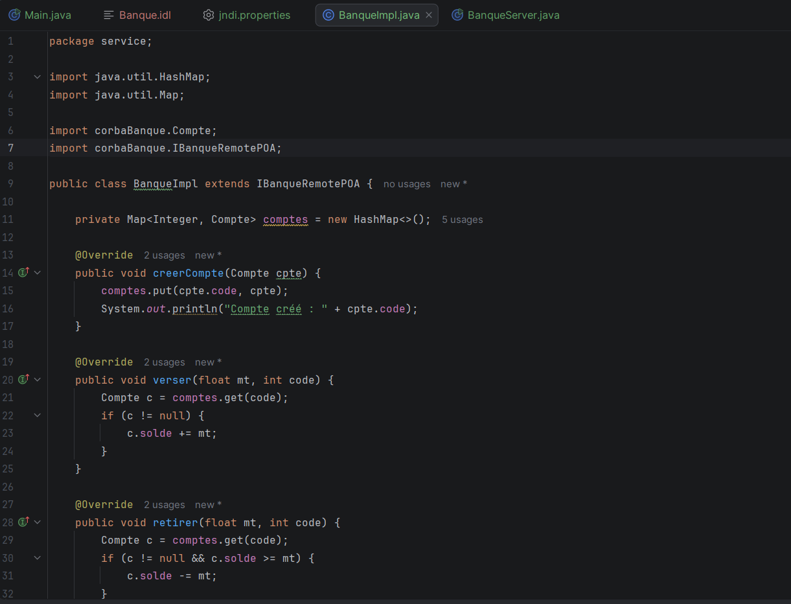
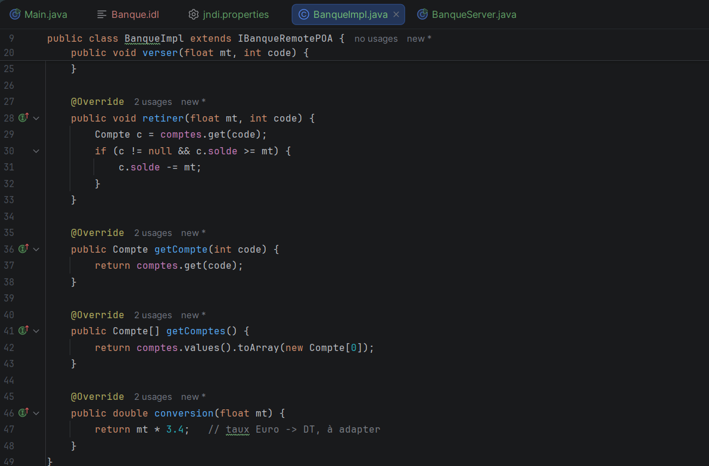
La classe BanqueImpl hérite de IBanqueRemotePOA et implémente toutes les méthodes de IBanqueRemoteOperations (code métier).

##  Fichier jndi.properties
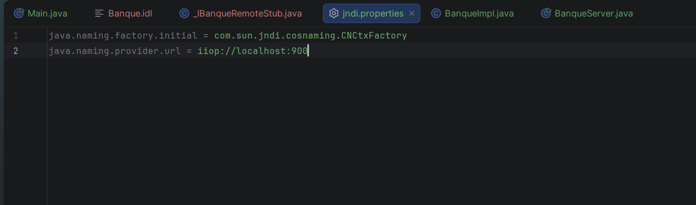

Le fichier jndi.properties contient l'adresse du Naming Service : la factory com.sun.jndi.cosnaming.CNCtxFactory et l'URL iiop://localhost:900.

**Synthèse :** Le serveur initialise l'ORB, récupère le RootPOA et active le POAManager, configure JNDI, crée le servant BanqueImpl, enregistre sa référence dans l'annuaire puis attend les requêtes des clients.

---

# Étape 3 : Développement du Client

##Projet TP6_CorbaBanque_Client 

##  Compilation de Banque.idl dans le projet client
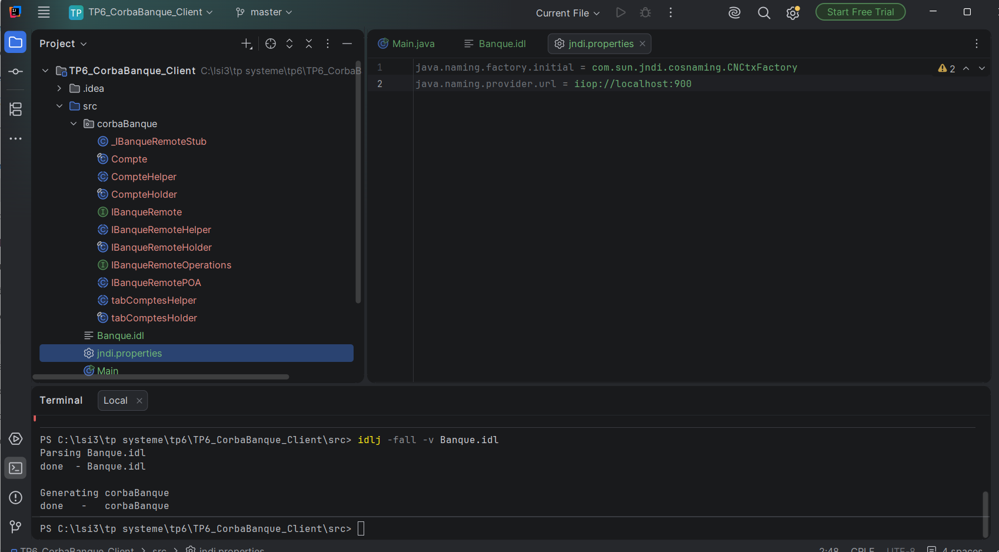

##  Classe corbaClient.BanqueClient
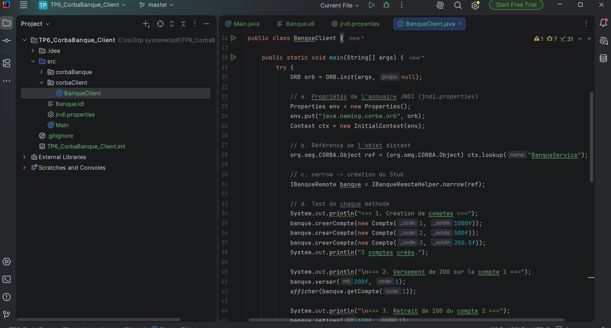

**Synthèse :** Le client récupère les propriétés JNDI, obtient la référence de l'objet distant, la convertit en IBanqueRemote avec IBanqueRemoteHelper.narrow pour créer le Stub, puis appelle à distance chaque méthode du service bancaire.

---

# Étape 4 : Exécution de l'application

L'ordre d'exécution est : Naming Service, puis Serveur, puis Client.

##  Lancement du Naming Service (tnameserv)
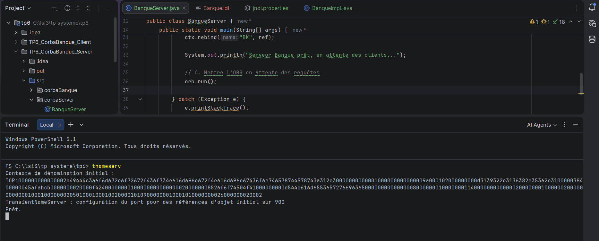

##  Exécution de BanqueServer
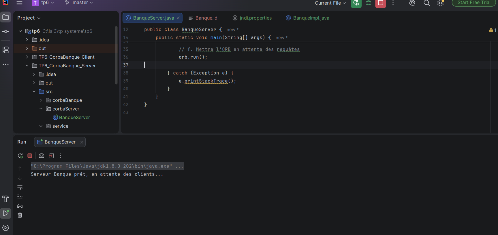

## Exécution de BanqueClient (création de comptes, versement, retrait)
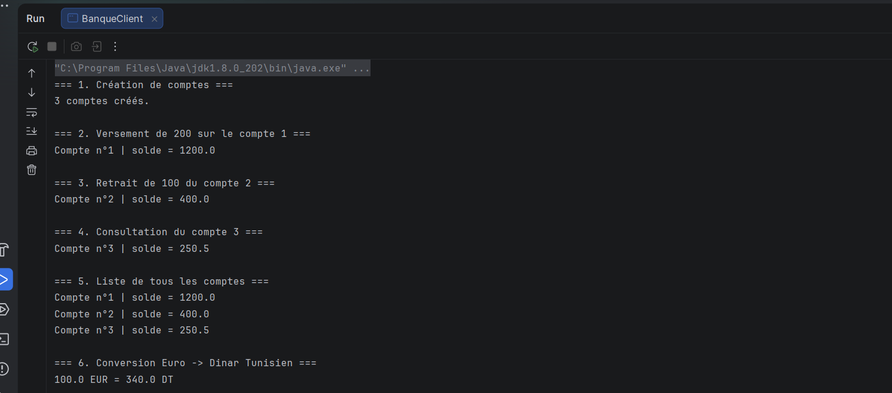

##  Exécution de BanqueClient (consultation d'un compte, liste des comptes, conversion Euro/DT)
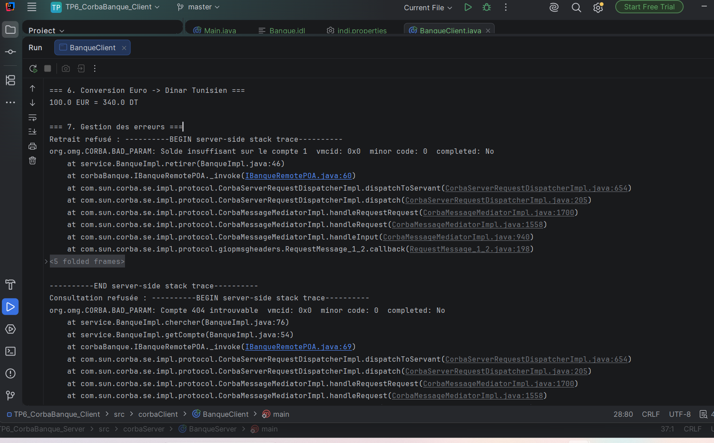
##  Exécution de BanqueServeur
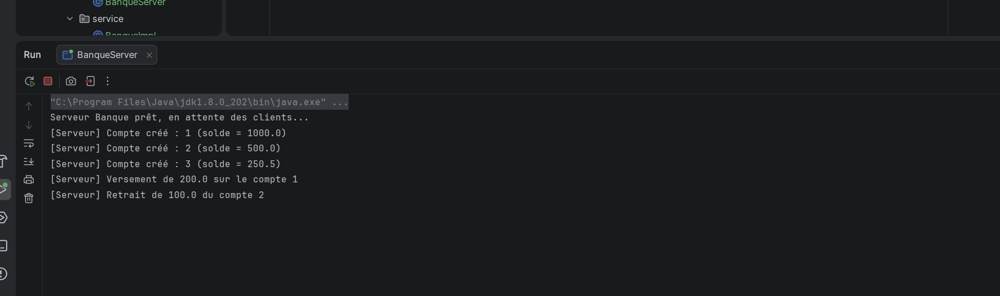
**Synthèse :** Toutes les opérations bancaires fonctionnent à distance : création, versement, retrait, consultation d'un compte, liste des comptes et conversion Euro/Dinar. Les résultats renvoyés par le serveur sont corrects.

---

# Conclusion

Ce TP a permis de mettre en œuvre une application répartie avec CORBA : définition de l'interface en IDL, génération du Stub et du Skeleton avec idlj, implémentation du servant, enregistrement de l'objet dans le Naming Service via JNDI, puis appel des méthodes distantes depuis un client Java.